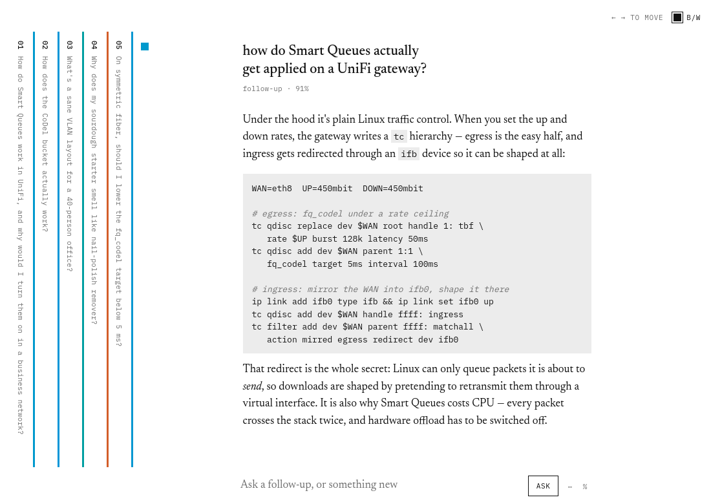

# Sidelong

A chat interface laid out sideways. Each question-and-answer pair is a
page. The open page sits in the middle of the screen; older pages
collapse into thin vertical strips on the left, so a long session reads
as a row of tabs instead of a scroll. Each page gets a colored mark.
Hue encodes topic, saturation encodes classifier confidence, so
follow-ups end up sharing their thread's color and you can find a
conversation in a stack of twenty pages without reading anything.



There are no API keys. Chat runs through the Claude Code CLI you're
already logged into, billed to your Claude subscription like any other
`claude` session. A deck is one Claude session, resumed turn by turn.
Topic embeddings come from a local Ollama model and never leave your
machine.

## Quick start

Two prerequisites:

1. [Claude Code](https://claude.com/claude-code), logged in. Install it
   and run `claude` once. Sidelong drives it headless (`claude -p`), so
   usage counts against your subscription's normal limits. The `%` glyph
   in the composer shows where the current window stands.
2. [Ollama](https://ollama.com), for embeddings. macOS/Windows: the app
   from [ollama.com/download](https://ollama.com/download). Linux:
   `curl -fsSL https://ollama.com/install.sh | sh`, or unpack the
   release tarball anywhere and put `bin/ollama` on your PATH (no root
   needed). You don't need to pull a model; the launcher does that.

Then, with Node.js 22+:

```
git clone https://github.com/canaanmckenzie/sidelong.git
cd sidelong
npm install     # dev deps only: typescript + @types/node; install scripts disabled
npm start
```

`npm start` preflights everything and says what's missing: it checks the
`claude` CLI, starts Ollama if it's installed but not running, pulls the
embedding model on first run (~670 MB, with progress), launches the two
servers, and prints `sidelong → http://localhost:5173`.

Arrow keys move between pages when the composer isn't focused. Clicking
a strip opens it. The deck persists in IndexedDB, so a reload restores
the pages and the Claude session behind them; follow-ups continue the
same conversation tomorrow. The `⋯` glyph holds the deck menu: export
to JSON, import, save & reset (export, then start fresh), or new deck.
If the server or Ollama is down,
questions still get colors from a bag-of-words fallback and the readout
says `offline`.

<details>
<summary>Running the pieces by hand instead</summary>

```
ollama serve       # embeddings       → localhost:11434
npm run server     # the thin server  → localhost:8787
npm run dev        # the app          → localhost:5173
```

Three processes, any order. `ollama pull mxbai-embed-large` once
beforehand.
</details>

## How the colors work

Every page has one mark: a 12px square on the open page, a 3px spine on
collapsed strips. A new question is placed on the color wheel near the
pages it's most similar to, so follow-ups inherit their thread's hue.
If nothing in the deck clears a similarity floor, the question is a new
topic and takes the midpoint of the widest empty arc, desaturated.
Saturation tracks the classifier's confidence in the match.

Placement runs three times as better information arrives:

1. On Enter, a bag-of-words cosine places the page instantly (this is
   also the offline fallback).
2. ~30 ms later, the question's embedding is scored against each page's
   question+answer embedding and the placement is redone. The color
   cross-fades; the page never moves.
3. When the answer finishes streaming, the page is scored again using
   question plus answer, and the verdict is allowed to change.

The line under each question is the verdict: `follow-up · 90%`.
`new topic` carries no percentage, since there is no match to be
confident in. If the post-answer re-score changed the verdict, the line
keeps the history: `new topic → follow-up · 84%`. Hovering it shows the
raw numbers (nearest page, cosine, hue).

The calibration constants are measured: `node tools/calibrate.js
<model>` prints the question-to-page cosine matrix over the fixture
deck. The default is `mxbai-embed-large` because the smaller models
tried here couldn't tell "same thread" from "same broad domain" — on
`nomic-embed-text`, a question about sardines outscored a genuine
networking follow-up.

## What talks to what

- Questions go to Anthropic through the `claude` CLI, exactly as in a
  normal Claude Code session. No other service is contacted.
- The Claude session can read local files to answer questions about
  them — `Read`, `Glob`, and `Grep` only, an allowlist with no shell,
  no writes, and no web tools. Every read streams into the answer as a
  small `→ read …` line, so you see what it looked at. `SIDELONG_TOOLS`
  widens the list if you want that; be deliberate about it, because a
  headless session has no permission prompt to catch a bad idea.
- Embeddings are computed locally by Ollama and stay on your machine.
- The thin server (`server/index.js`) binds 127.0.0.1 only, holds no
  credentials, and does two things: spawn `claude -p` and call Ollama.
  A turn that goes silent for two minutes is killed and reported
  rather than left hanging.
- The deck lives in your browser's IndexedDB and in JSON files you
  export.

## Configuration (environment, all optional)

| Variable | Default | |
| --- | --- | --- |
| `PORT` | `8787` | thin-server port |
| `SIDELONG_ORIGIN` | `http://localhost:5173` | CORS origin for the app |
| `CLAUDE_BIN` | `claude` | the CLI that chat runs through |
| `OLLAMA_URL` | `http://127.0.0.1:11434` | where embeddings come from |
| `EMBED_MODEL` | `mxbai-embed-large` | if you swap it, re-fit `EMB` in `src/jev.js` with `tools/calibrate.js` |
| `SIDELONG_TOOLS` | `Read Glob Grep` | the CLI's tool allowlist — read-only on purpose |
| `SIDELONG_STALL_MS` | `120000` | how long a silent turn lives before the stall guard kills it |

## Shape

Plain JavaScript, native ES modules, no framework, no build step, zero
runtime dependencies. Dev dependencies are exactly `typescript` and
`@types/node`; `.npmrc` disables install scripts and pins exact
versions. Types are JSDoc comments checked by `tsc --noEmit`
(`npm run check`); tests run on Node's built-in runner (`npm test`).

- `src/jev.js` — the classifier and the OKLCH painter; pure functions,
  one `place()` shared by the word-match and embedding paths
- `src/deck.js` — rendering, navigation, the composer, streaming
- `src/md.js` — markdown reader (pure parser; the DOM is built via
  `textContent`, no injection path)
- `src/hl.js` — monochrome syntax highlighting; the design allows no
  color beyond the topic marks, so code structure comes from weight,
  slant, and ink level
- `src/chat.js` — streaming client for the thin server
- `src/limits.js` — the `%` usage glyph and its readout
- `src/deckmenu.js` — the `⋯` glyph: export / import / save & reset / new deck
- `src/bubble.js` — the thought-bubble dialog that stands in for
  `confirm()` and `alert()`
- `src/store.js` — deck state, persisted to IndexedDB; JSON export/import
- `src/theme.js` — the black-on-white and slate-with-cream palettes
- `src/fixtures.js` — the five seed pages, also used by the tests
- `src/types.js` — the data shapes (JSDoc typedefs)
- `server/index.js` — `POST /chat` spawns `claude -p` (stream-json in,
  simplified SSE out), `POST /embed` calls Ollama, `GET /healthz`
- `server/sse.js` — stream parsing and translation; pure functions
- `tools/start.js`, `tools/serve.js`, `tools/calibrate.js` — launcher,
  dev server, calibration

`HANDOFF.md` is the design document: interaction model, visual spec,
the classifier math, acceptance criteria. `SESSION-NOTES.md` tracks the
build session to session. `prototype/sidelong.html` is the original
one-file prototype.

## Caveats

- One deck at a time. Two open app tabs will race the save
  (last writer wins).
- Needs a Claude subscription. Chat deliberately rides the CLI login
  instead of an API key, so without one there's nothing to talk to.
- The markdown renderer covers paragraphs, fenced code, headings, lists,
  blockquotes, and inline code/bold/italic/links. No tables or images.
- A hue circle is one dimension and topics aren't, so with enough
  distinct topics two unrelated threads will eventually sit at nearby
  angles. Accepted for v1; HANDOFF.md discusses it.
- Milestones 1–6 of the plan are done (scaffold, server, chat,
  classifier, re-color, persistence). Remaining: trackpad paging and
  strip overflow handling past ~30 pages.

## License

[MIT](LICENSE)
